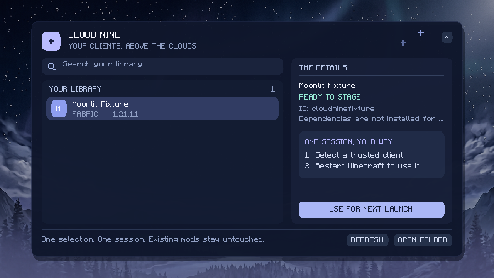

# Cloud Nine — Fabric client selector (prototype)

A celestial, restart-based client library for **Minecraft Java 1.21.11 / Fabric**. Press **Right Alt** (rebindable in Controls) to open it. Cloud Nine lists source ZIPs by their exact filenames, pairs them with matching compiled Fabric JARs, and stages one for the next launch.



> **Prototype / source-folder status:** the requested Drive clients are not included or claimed to be compatible. Source ZIPs are not executable mods: they must be inspected and built separately for 1.21.11.

## Install

1. Install Minecraft Java **1.21.11**, Fabric Loader **0.19.3+**, and a matching **Fabric API**. Java 21 is required.
2. Put the Cloud Nine JAR in that installation's `mods` folder. Start Minecraft once.
3. Press **Right Alt**, then **OPEN FOLDER**. Put trusted, compiled **Fabric 1.21.11** `.jar` files there and press **REFRESH**. To display a source's exact ZIP filename, place the ZIP alongside a JAR with the same basename (for example `Example.zip` and `Example.jar`). A ZIP without a matching JAR is shown as unavailable; Cloud Nine never executes or builds source archives. A standalone JAR is listed by its filename without `.jar`.
4. Select a client, press **USE FOR NEXT LAUNCH**, and wait for the restart confirmation. Quit Minecraft, then start the same installation again. Cloud Nine stages only that selected JAR; it does **not** install its dependencies. Check its requirements and install those separately.
5. The selected copy is meant for one session. A small local Java cleanup helper waits for Minecraft to exit and deletes only Cloud Nine's own unchanged copy. Wait a few seconds before the following launch. The original library JAR is never removed.

Cloud Nine **does not hot-load or unload Fabric or running mods** and does not restart the game itself. Fabric discovers mods at startup. Metadata checks are only a preliminary filter: compatibility, dependencies, licensing, and code safety are **not guaranteed**. A mod can run arbitrary code, so use only files you trust.

Other mods already in `mods` are deliberately **left untouched** and remain loaded. For an experience with only Cloud Nine, Fabric API, and the selected client, use a **separate Minecraft launcher installation/game directory** containing only those baseline mods and the necessary dependencies. Do not run multiple Minecraft instances against that same directory while switching.

### Recovery

If a selected JAR crashes Fabric before Cloud Nine starts, or if a launcher forcibly terminates the cleanup helper, the one-session copy can remain. With Minecraft closed, open that installation's `mods` folder and remove the file named `cloudnine-once-<UUID>.jar`. Do not remove your other mods or the original in `cloudnine/clients`. Cloud Nine never deletes a managed JAR if its saved checksum has changed. If your launcher keeps a lock on the file, close the launcher before removing it.

## Build and test

```sh
./gradlew build
```

The GitHub Actions workflow runs unit tests, builds the mod, then launches a **real Minecraft client in a production-like Fabric environment** under Xvfb/software OpenGL, using the remapped distributable JAR. After the loading overlay clears, it sends Right Alt and mouse events through Minecraft's GLFW callbacks, selects a ZIP-only fixture, adds its compiled JAR, refreshes while keeping the ZIP name selected, then stages it through the UI and relaunches and checks that Fabric actually initializes it, then launches once more to check one-session cleanup. The screenshot shows the test fixture, which is not distributed in the mod. Logs and a screenshot are uploaded as workflow artifacts.

## Privacy and storage

This GitHub repository is public. Do not commit private source archives or clients without checking you have permission to publish them. GitHub repository, Git LFS, release, and Actions artifact limits are separate; using the command line does not create a guaranteed 100 GB repository allowance.
